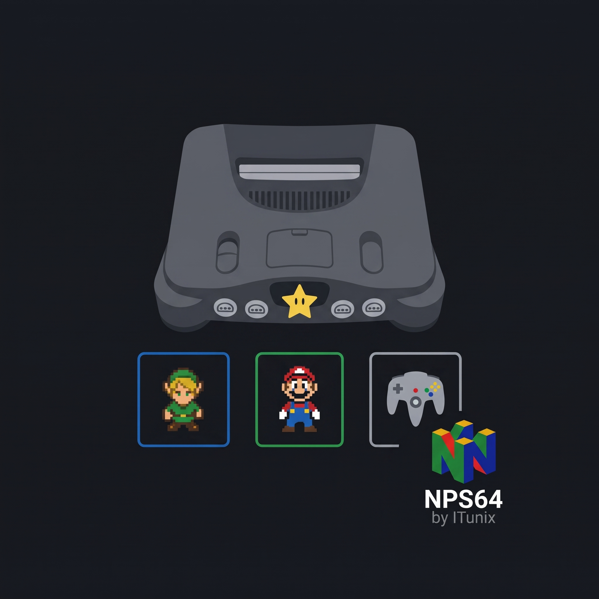
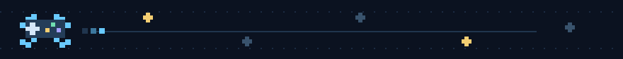

  
  

  

<h1 align="center">NPS64 by lTunix</h1>

Preservando videojuegos de Nintendo 64 en PlayStation 4.

  
  
  
  

  

  

**NPS64 es una aplicación en desarrollo** para volver a disfrutar juegos de Nintendo 64 en PS4. Su objetivo es contribuir a la preservación de videojuegos y mantener vivas sus historias, mundos y experiencias.

Todavía estamos mejorando la compatibilidad, el rendimiento y la experiencia de uso. Algunos juegos pueden presentar errores o funcionar más lento de lo esperado.

## Descargar

**[Descargar la última versión](https://github.com/lTunix/NPS64/releases/latest)** · [Ver versiones anteriores](https://github.com/lTunix/NPS64/releases)

Descarga el archivo **PKG**. Este enlace siempre abre la versión más reciente. Las versiones publicadas están en desarrollo; tus pruebas nos ayudan a mejorarlas.

## Comenzar a jugar

1. Instala el PKG en una PS4 preparada para ejecutar aplicaciones de la comunidad.
2. Copia tus juegos de Nintendo 64 en `/data/NPS64/games`.
3. Abre **NPS64 by lTunix** y selecciona un juego con **X**.

Se admiten archivos `.n64`, `.z64` y `.v64`. La aplicación no incluye juegos: utiliza tus propias copias.

La biblioteca descarga carátulas desde Libretro y las guarda en `/data/NPS64/covers` para usarlas sin conexión. Si una portada no aparece, puedes copiar allí un PNG de hasta 1024 × 1024 píxeles con el mismo nombre del juego, cambiando únicamente su extensión por `.png`.

Durante una partida, pulsa **L3 + R3** para abrir el menú de pausa. Desde allí puedes guardar o cargar una partida y volver a la biblioteca.

Los juegos compatibles con Rumble Pak pueden hacer vibrar el mando. Está activado por defecto para los cuatro jugadores. En el menú de pausa, **Accesorio** permite elegir Rumble Pak, Memory Pak o ninguno; la elección se guarda. La vibración se detiene al pausar o volver a la biblioteca.

En la biblioteca, **Options** sale de NPS64; durante la partida conserva su función de Start de Nintendo 64.

## Novedades de 00.75

- Biblioteca renovada con carrusel animado de cartuchos 3D, carátulas integradas y reflejos.
- Nuevo diseño de fondos, emblema, tarjetas de acciones, menús y botones, adaptado a inglés y español.
- Navegación por la biblioteca con la cruceta y cambio de página con L1/R1; accesos a ajustes generales y por juego.
- Las actualizaciones disponibles muestran una ventana para **Descargar** o **Más tarde**. La descarga muestra progreso, permite cancelar y presenta el resultado o la opción de reintentar.
- El PKG se verifica antes de quedar listo en `/data/pkg`; su instalación sigue siendo manual.
- Conserva las mejoras de emulación de 00.74. [Notas completas](docs/RELEASE-00.75.md).

### Pendientes conocidos

- **Army Men:** reducir los tirones y bajones que quedan con explosiones y muchos efectos a 2×.
- **Conker’s Bad Fur Day:** optimizar los bajones de la intro y otras escenas exigentes; no se considera resuelto.
- **Mario Tennis:** seguir mejorando las repeticiones y partículas a 2×.
- Continuar las pruebas prolongadas y de más juegos. No se garantizan 60 FPS constantes.

## Idioma

La **00.75** usa **inglés por defecto**. En **Settings → Language**, elige **English** o **Espanol**; el cambio se aplica inmediatamente y se guarda al cerrar la app. Los ajustes antiguos conservan sus opciones y comienzan en inglés. Este ajuste cambia la interfaz de NPS64, no el idioma de las ROMs.

## Ajustes de imagen

Selecciona **Ajustes del juego** en la biblioteca o abre **L3 + R3** durante la partida. Las selecciones se guardan por separado para cada juego.

| Formato | Comportamiento |
|---|---|
| **4:3** | Proporciones originales de pantalla. |
| **16:9 (estirado)** | Ocupa la pantalla ancha estirando la imagen. |
| **16:9 experimental** | Aplica un parche de proyección específico del juego y muestra el resultado en 16:9. |

El widescreen experimental admite por ahora **Super Mario 64 USA Rev 0** y **Super Smash Bros. USA Rev 0**. NPS64 comprueba CRC de cabecera, región, revisión y tamaño; las versiones no compatibles omiten esta opción. Se activa o desactiva desde la fila de aspecto, por separado de Trucos. La imagen se actualiza al continuar la partida. Algunas escenas o elementos del HUD pueden presentar problemas visuales. Ocarina of Time todavía no está incluido en este catálogo inicial.

La **resolución interna nativa / 2×** también cambia en vivo desde la pausa, sin recargar la ROM. El primer cambio puede preparar brevemente los recursos de GPU mientras el juego está pausado; se muestra la nueva resolución al continuar.

## Trucos (experimental)

NPS64 incluye la base GameShark de Mupen64Plus y busca códigos por CRC de cabecera y región de la ROM, no por nombre de archivo. Abre **Ajustes del juego → Trucos** desde la biblioteca o **Trucos** en la pausa **L3 + R3**. **X** activa/desactiva, **L1/R1** cambia de página, **Cuadrado** desactiva todos y **Círculo** vuelve. Durante la partida, **R2** funciona como botón GameShark para los códigos que lo requieran.

Todos comienzan desactivados. La selección se guarda por ROM; las variantes son excluyentes y se permiten hasta 32 activos. Se incluyen opciones de parámetros y se omiten 29 entradas incompatibles o mal formadas. Algunos códigos requieren reiniciar el juego; desactivarlos no revierte todos los cambios, incluidos los guardados por el juego. No se modifica el archivo de la ROM.

## Actualizaciones

Al abrir la aplicación, NPS64 busca nuevas versiones en GitHub y las descarga automáticamente en `/data/pkg`. También puedes elegir **Buscar actualizaciones** en Configuración o en el menú de pausa.

El menú muestra el progreso de la descarga. Cuando termine, instala el nuevo PKG desde el instalador de tu PS4.

## Funciones actuales

- [x] Biblioteca y menú de pausa en HD, con texto suavizado.
- [x] Carátulas automáticas, guardadas para usarlas sin conexión.
- [x] Carátulas personalizadas en PNG.
- [x] Juegos en formato `.n64`, `.z64` y `.v64`.
- [x] Soporte para hasta cuatro mandos.
- [x] Rumble Pak en juegos compatibles, confirmado en PS4.
- [x] Selección de Rumble Pak, Memory Pak o ningún accesorio.
- [x] Guardado de partidas y ocho ranuras de estados por juego.
- [x] Pausa y regreso a la biblioteca.
- [x] Selección de imagen 4:3 o 16:9 y filtro de imagen.
- [x] Contador de FPS durante la partida.
- [x] Búsqueda automática y manual de actualizaciones.
- [x] Descarga de actualizaciones en `/data/pkg`, con comprobación de integridad.
- [ ] Instalación de actualizaciones desde la propia aplicación.
- [x] Mejorar la compatibilidad y el rendimiento en juegos exigentes.
- [x] Renderizado Vulkan con Mesa RADV, probado en PS4 física.
- [x] Cambio de resolución interna nativa / 2× en vivo, guardado por juego.
- [x] Perfiles 16:9 experimentales opcionales para versiones de ROM compatibles.
- [x] Configuración desde la biblioteca y selección de información/FPS en pantalla.

Desde la **00.70**, el PKG público incorpora el renderizador Vulkan probado en PS4. Incluye mejoras de fluidez, presentación a 2× y continuidad del audio. El rendimiento depende del juego y la escena; no se garantizan 60 FPS constantes.

La biblioteca y los menús se muestran en 16:9. El aspecto 4:3 o 16:9, la resolución interna y los demás ajustes de partida se guardan por juego; puedes cambiarlos desde sus ajustes o con **L3 + R3**.

## Compatibilidad: Majora’s Mask

En las pruebas de PS4, **The Legend of Zelda: Majora’s Mask de GameCube Collector’s Edition** presentó audio lento, distorsionado y cortes, además de peor fluidez que la edición de cartucho. **Se recomienda usar un volcado propio de la versión normal de Nintendo 64 (cartucho)**. Las correcciones de audio mejoran la reproducción general, pero no garantizan resolver las particularidades de Collector’s Edition.

Mario Tennis también recibió correcciones de arranque, comprobadas durante las pruebas. La aparición de objetos a distancia conserva el comportamiento del juego; esta versión no incorpora parches de distancia de dibujado.

## Paso desde las versiones de prueba Vulkan

La 00.70 actualiza la aplicación original **NPSX00064** y utiliza `/data/NPS64/saves`, `/data/NPS64/settings.cfg` y `/data/NPS64/game-settings`. Las versiones de prueba **NPSV00064** usaban carpetas `vulkan-test-*`; esas partidas y configuraciones se conservan y no se migran automáticamente. Antes de trasladarlas manualmente, respalda ambas carpetas y cierra la aplicación.

## Ayúdanos a mejorar

Si encuentras un problema, [abre un reporte](https://github.com/lTunix/NPS64/issues) indicando el juego, la versión de NPS64 y qué ocurrió. Una imagen o un video también ayuda.

## Preservación y comunidad

Preservar un videojuego también significa conservar la posibilidad de jugarlo. NPS64 busca aportar a ese esfuerzo, con un proyecto abierto que pueda seguir creciendo gracias a la comunidad.

Creado por **lTunix**, sobre el trabajo de los proyectos y colaboradores reconocidos en [Créditos](docs/CREDITS.md).

[Licencia](LICENSE) · [Código fuente](https://github.com/lTunix/NPS64)
