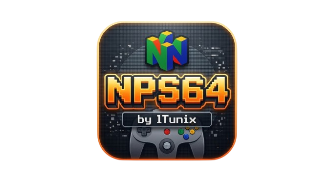

  

<h1 align="center">NPS64 by lTunix</h1>

Preservando videojuegos de Nintendo 64 en PlayStation 4.

**NPS64 es una aplicación en desarrollo** para volver a disfrutar juegos de Nintendo 64 en PS4. Su objetivo es contribuir a la preservación de videojuegos y mantener vivas sus historias, mundos y experiencias.

Todavía estamos mejorando la compatibilidad, el rendimiento y la experiencia de uso. Algunos juegos pueden presentar errores o funcionar más lento de lo esperado.

## Descargar

**[Descargar la última versión](https://github.com/lTunix/NPS64/releases/latest)** · [Ver versiones anteriores](https://github.com/lTunix/NPS64/releases)

Descarga el archivo **PKG**. Este enlace siempre abre la versión más reciente. Las versiones publicadas están en desarrollo; tus pruebas nos ayudan a mejorarlas.

## Comenzar a jugar

1. Instala el PKG en una PS4 preparada para ejecutar aplicaciones de la comunidad.
2. Copia tus juegos de Nintendo 64 en `/data/NPS64/games`.
3. Abre **NPS64 by lTunix** y selecciona un juego con **X**.

Se admiten archivos `.n64`, `.z64` y `.v64`. La aplicación no incluye juegos: utiliza tus propias copias.

La biblioteca descarga carátulas desde Libretro y las guarda en `/data/NPS64/covers` para usarlas sin conexión. Si una portada no aparece, puedes copiar allí un PNG de hasta 1024 × 1024 píxeles con el mismo nombre del juego, cambiando únicamente su extensión por `.png`.

Durante una partida, pulsa **L3 + R3** para abrir el menú de pausa. Desde allí puedes guardar o cargar una partida y volver a la biblioteca.

Los juegos compatibles con Rumble Pak pueden hacer vibrar el mando. Está activado por defecto para los cuatro jugadores. En el menú de pausa, **Accesorio** permite elegir Rumble Pak, Memory Pak o ninguno; la elección se guarda. La vibración se detiene al pausar o volver a la biblioteca.

## Actualizaciones

Al abrir la aplicación, NPS64 busca nuevas versiones en GitHub y las descarga automáticamente en `/data/pkg`. También puedes pulsar **L2** en la biblioteca o elegir **Buscar actualizaciones** en el menú de pausa.

El menú muestra el progreso de la descarga. Cuando termine, instala el nuevo PKG desde el instalador de tu PS4.

## Funciones actuales

- [x] Biblioteca y menú de pausa en HD, con texto suavizado.
- [x] Carátulas automáticas, guardadas para usarlas sin conexión.
- [x] Carátulas personalizadas en PNG.
- [x] Juegos en formato `.n64`, `.z64` y `.v64`.
- [x] Soporte para hasta cuatro mandos.
- [x] Rumble Pak en juegos compatibles, confirmado en PS4.
- [x] Selección de Rumble Pak, Memory Pak o ningún accesorio.
- [x] Guardado de partidas y ocho ranuras de estados por juego.
- [x] Pausa y regreso a la biblioteca.
- [x] Selección de imagen 4:3 o 16:9 y filtro de imagen.
- [x] Contador de FPS durante la partida.
- [x] Búsqueda automática y manual de actualizaciones.
- [x] Descarga de actualizaciones en `/data/pkg`, con comprobación de integridad.
- [ ] Instalación de actualizaciones desde la propia aplicación.
- [ ] Mejorar la compatibilidad y el rendimiento en juegos exigentes.
- [ ] Renderizado con Vulkan listo para uso general.

Esta versión utiliza el renderizado por CPU. Las pruebas con Vulkan siguen en desarrollo y no forman parte de este PKG.

## Mira cómo funciona

Los [clips de la versión 00.67](docs/PRUEBAS-00.67.md) muestran varios juegos con los FPS visibles. Están grabados en un emulador de PS4 en PC; el rendimiento en una consola puede ser diferente.

## Ayúdanos a mejorar

Si encuentras un problema, [abre un reporte](https://github.com/lTunix/NPS64/issues) indicando el juego, la versión de NPS64 y qué ocurrió. Una imagen o un video también ayuda.

## Preservación y comunidad

Preservar un videojuego también significa conservar la posibilidad de jugarlo. NPS64 busca aportar a ese esfuerzo, con un proyecto abierto que pueda seguir creciendo gracias a la comunidad.

Creado por **lTunix**, sobre el trabajo de los proyectos y colaboradores reconocidos en [Créditos](docs/CREDITS.md).

[Licencia](LICENSE) · [Código fuente](https://github.com/lTunix/NPS64)
