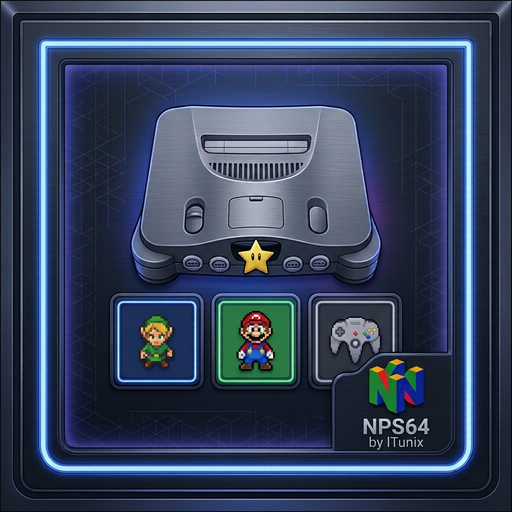
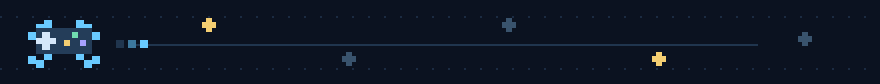

  
  

  

<h1 align="center">NPS64 by lTunix</h1>

Preserving Nintendo 64 games on PlayStation 4.

  
  
  
  

  

  

**NPS64 is an application in development** for enjoying Nintendo 64 games on PS4. Its goal is to help preserve games and keep their stories, worlds and experiences alive.

Compatibility, performance and usability are still improving. Some games may have errors or run slower than expected.

## Download

**[Download the latest release](https://github.com/lTunix/NPS64/releases/latest)** · [Previous releases](https://github.com/lTunix/NPS64/releases)

Download the **PKG** file. This link always opens the latest published release. Releases are under development; your testing helps improve them.

## Getting started

1. Install the PKG on a PS4 configured to run community applications.
2. Copy your Nintendo 64 games to `/data/NPS64/games`.
3. Open **NPS64 by lTunix** and select a game with **X**.

Supported formats: `.n64`, `.z64` and `.v64`. No games are included: use your own copies.

The library downloads cover art from Libretro and stores it in `/data/NPS64/covers` for offline use. If a cover is missing, you can place a PNG up to 1024 × 1024 pixels in that folder, using the game's filename with its extension changed to `.png`.

During gameplay, press **L3 + R3** to open the pause menu. You can save or load a state, change display settings and return to the library. In the library, **Options** exits NPS64; during gameplay it remains the Nintendo 64 Start button.

Games supporting Rumble Pak can vibrate the controller. It is enabled by default for all four players. The pause menu's **Accessory** setting selects Rumble Pak, Memory Pak or none, and remembers your choice. Vibration stops when pausing or returning to the library.

## Language

The **00.73** interface defaults to **English**. In **Settings → Language**, choose **English** or **Espanol**. Changes take effect immediately and are saved. Existing settings keep their other preferences and initially use English. This changes the NPS64 interface, not the language of your ROMs.

## Display settings

Select **Game settings** in the library or open **L3 + R3** during gameplay. Settings are saved separately for each game.

| Format | Behaviour |
|---|---|
| **4:3** | Original display proportions. |
| **16:9 (stretched)** | Fills a widescreen display by stretching the image. |
| **16:9 experimental** | Applies a game-specific projection patch and displays the result in 16:9. |

Experimental widescreen currently supports **Super Mario 64 USA Rev 0** and **Super Smash Bros. USA Rev 0**. NPS64 checks the ROM header CRC, region, revision and size; unsupported versions skip this option. Switch it on or off from the aspect-ratio row, independently of Cheats. The picture updates when gameplay resumes. Some scenes or HUD elements may still have visual issues. Ocarina of Time is not included in this initial catalog.

**Native / 2× internal resolution** can also be changed live from the pause menu, without reloading the ROM. The first change may briefly prepare GPU resources while paused; the selected resolution takes effect when gameplay resumes.

## Cheats (experimental)

NPS64 includes the Mupen64Plus GameShark database and selects entries using the ROM header CRC and country, not its filename. Open **Game settings → Cheats** from the library, or **Cheats** in the **L3 + R3** pause menu. Press **X** to toggle a code, **L1/R1** to change pages, **Square** to disable all and **Circle** to return. In gameplay, **R2** acts as the GameShark button for codes that require it.

Cheats are off by default. Selections are saved per ROM; variants of a code are mutually exclusive, with up to 32 active entries. The catalog includes parameter choices and omits 29 entries with unsupported/malformed formats. Some codes require a game restart and disabling a cheat cannot undo every change already made, including changes saved by a game. This feature does not change the ROM language or patch the ROM file.

## Updates

When the application opens, NPS64 checks GitHub for new releases and automatically downloads them to `/data/pkg`. You can also select **Check for updates** in Settings or the pause menu.

The menu shows download progress. Once complete, install the new PKG using your PS4's package installer.

## Current features

- [x] HD library and pause menus with antialiased text.
- [x] Automatic cover downloads with offline caching.
- [x] Custom PNG covers.
- [x] `.n64`, `.z64` and `.v64` games.
- [x] Up to four controllers.
- [x] Rumble Pak in compatible games, confirmed on PS4.
- [x] Rumble Pak, Memory Pak or no accessory.
- [x] Game saves and eight save state slots per game.
- [x] Pause and return to the library.
- [x] 4:3 or 16:9 game aspect ratio and image filtering.
- [x] In-game FPS display.
- [x] Automatic and manual update checks.
- [x] Verified update downloads to `/data/pkg`.
- [x] Vulkan rendering with Mesa RADV, tested on physical PS4 hardware.
- [x] Live native / 2× internal resolution changes, saved per game.
- [x] Optional experimental 16:9 profiles for compatible ROM versions.
- [x] Library settings and configurable FPS/details overlay.
- [ ] Install updates directly from the application.
- [x] Improve compatibility and performance in demanding games.

Since **00.70**, the public PKG includes the Vulkan renderer tested on PS4. It improves smoothness, 2× presentation and audio continuity. Performance depends on the game and scene; a constant 60 FPS is not guaranteed.

The library and menus use 16:9. Game aspect ratio, internal resolution and other gameplay settings are saved per game and can be changed through game settings or **L3 + R3**.

## Compatibility: Majora's Mask

In PS4 testing, **The Legend of Zelda: Majora's Mask from GameCube Collector's Edition** had slow, distorted and interrupted audio, and ran less smoothly than the cartridge edition. **We recommend using your own dump of the standard Nintendo 64 cartridge version.** General audio improvements do not guarantee that Collector's Edition issues are resolved.

Mario Tennis also received startup fixes verified during testing. This version does not include patches to extend draw distance.

## Moving from Vulkan test builds

00.70 updates the original **NPSX00064** application and uses `/data/NPS64/saves`, `/data/NPS64/settings.cfg` and `/data/NPS64/game-settings`. The **NPSV00064** test builds used `vulkan-test-*` folders. Those saves and settings are preserved but are not migrated automatically. Back up both folders and close the application before moving files manually.

## Help improve NPS64

If you encounter a problem, [open an issue](https://github.com/lTunix/NPS64/issues) with the game, NPS64 version and what happened. Screenshots or video can help.

## Preservation and community

Preserving a game also means preserving the ability to play it. NPS64 contributes through an open project that can grow with the community.

Created by **lTunix**, building on the projects and contributors acknowledged in [Credits](docs/CREDITS.md).

[License](LICENSE) · [Source code](https://github.com/lTunix/NPS64)
